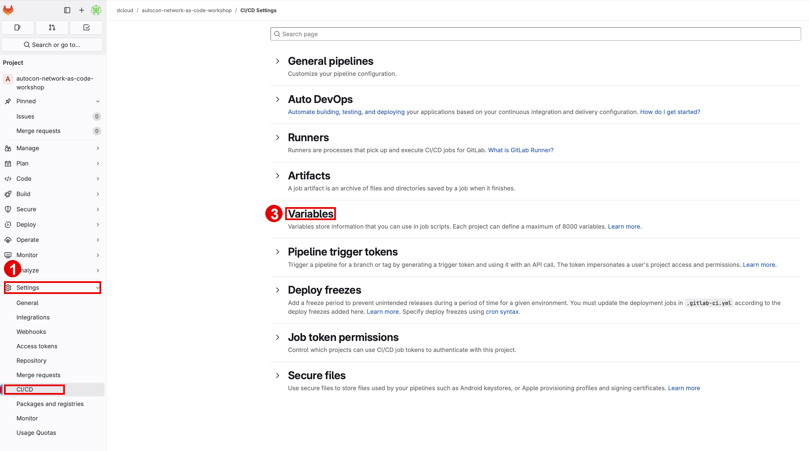
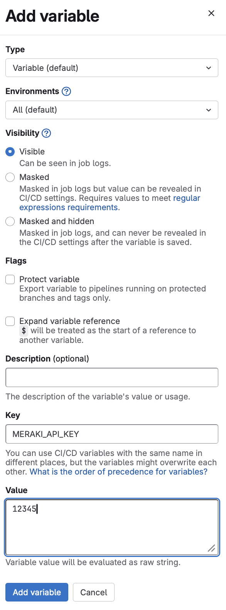

# Cheat Sheet

Quick reference for lab access, commands, and YAML syntax used throughout
both parts of the workshop.

## Lab access

| System | Address | Username | Password |
|---|---|---|---|
| Meraki Dashboard | [dashboard.meraki.com](https://dashboard.meraki.com) | *(provided separately)* | *(provided separately)* |
| Starter Repo (public, clone from here) | `TODO-starter-repo-url` | - | - |
| GitLab (your project, push here) | `TODO-gitlab-url` | dcloud | C1sco12345 |
| Windows Jump Machine | `TODO-jump-host-url` | - | C1sco12345 |

### IOS-XE devices

All 4 devices share one set of NETCONF/SSH credentials.

| Device | IP Address |
|---|---|
| Border | 198.18.128.201 |
| Core | 198.18.128.202 |
| Access1 | 198.18.128.204 |
| Access2 | 198.18.128.205 |

- Username: `nac_admin`
- Password: `cisco`

## nac CLI commands

Run from `meraki/` or `ios-xe/` after sourcing your `.env`:

```sh
source .env
nac init
nac plan
nac apply
```

Other useful commands:

```sh
nac validate                # schema + semantic validation of the data model
nac test                    # post-deployment tests against the live devices
terraform validate          # check .tf syntax/config without touching devices
terraform fmt -recursive    # format .tf files
terraform state list        # list resources Terraform currently manages
terraform output            # show output values after apply
```

## Environment variables

Set in `.env` (copy from `.env.example`, never commit the real file).

| Variable | Used for |
|---|---|
| `MERAKI_API_KEY` | Meraki Dashboard API auth |
| `org_name` | `!env org_name` - Meraki organization name |
| `branch_name` | `!env branch_name` - your pod's unique network name |
| `branch_mx_serial` / `branch_ms_serial` / `branch_cw_serial` | Appliance/switch/wireless device serials for your pod |
| `IOSXE_USERNAME` / `IOSXE_PASSWORD` | Shared NETCONF/SSH credentials for all 4 IOS-XE devices (username `nac_admin`) |

See `meraki/README.md` and `ios-xe/README.md` for the complete variable
lists, including the non-secret example credentials (SNMP, RADIUS, local
status page, etc.).

## Running the GitLab pipeline

The `.env` variables above are for running Terraform **locally**. The GitLab
pipeline (`.gitlab-ci.yml`) doesn't read `.env` - it needs its own copy of
your pod-specific values, set as **GitLab CI/CD Variables** instead
(Project → Settings → CI/CD → Variables → **Add variable**):

<figure markdown="span">
  { width="80%" }<figcaption>In
  your GitLab project: **(1)** Settings → **(2)** CI/CD → **(3)** Variables,
  then **Add variable**.</figcaption>
</figure>

When you add `MERAKI_API_KEY` (masked + protected), add the five variables
listed alongside it below - one shared with your partner (`org_name`) and
four specific to your pod. They are kept out of `.gitlab-ci.yml` so nobody
has to edit the pipeline file (and so pod hardware serials don't end up
committed to Git history):

| Variable | Value |
|---|---|
| `MERAKI_API_KEY` | your personal Meraki Dashboard API key |
| `org_name` | your workshop's Meraki organization name |
| `branch_name` | your pod's unique network name |
| `branch_mx_serial` | your pod's MX appliance serial |
| `branch_ms_serial` | your pod's MS switch serial |
| `branch_cw_serial` | your pod's CW access point serial |

<figure markdown="span">
  { width="50%" }<figcaption>The
  **Add variable** dialog, with `MERAKI_API_KEY` as an example - set
  **Visibility** to **Masked** and check **Protect variable** for this one,
  since it's the one real secret.</figcaption>
</figure>

Everything else the pipeline needs (shared hub network name, example SNMP/
RADIUS/local-status-page credentials, Terraform state backend settings) is
already defined inline in `.gitlab-ci.yml` and needs no changes.

## YAML syntax quick reference

- **`!env VAR_NAME`** - resolves to the value of environment variable
  `VAR_NAME` at apply time. Keeps secrets and pod-specific values (like
  `branch_name`) out of version control while the YAML structure stays
  stable.
- **Merge by `name`** - the `nac-*` Terraform modules read every YAML file
  under `data/`, deep-merging them into one model by matching `name` at each
  nesting level. Two files both containing `name: !env branch_name` merge
  into a single object instead of producing two.
- **File naming is reading order, not deployment order** - numeric prefixes
  (`1_`, `2_`, `3_`...) are a suggested teaching path; Terraform builds its
  own dependency graph from the merged model regardless of file name.
- **`${VARIABLE}`** - template-style placeholders (e.g. `${HOSTNAME}`,
  `${SITE}`) resolved from `variables:` blocks defined at the global,
  device-group, or device level, with device-level taking precedence.

---

**← Previous:** [Overview](Intro01_overview.md)
