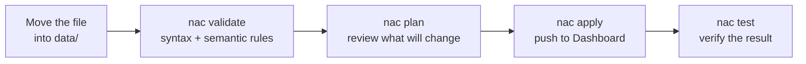

# Step 1 - Access Your Meraki Organization

## Overview

In Part 1 - Meraki you build a single Meraki branch network - appliance (MX),
switch (MS), and wireless (CW) - entirely from YAML. Each step's file waits
in `meraki/data-lab-task/`, and you move it into `meraki/data/` when you
reach that step.

| Step | What you configure | File |
|---|---|---|
| 1 - Access your Meraki organization (this page) | Log in to Dashboard, find your lab organization, create an API key | - |
| 2 - [Organization global settings](Meraki02_org_global.md) | Login security, SNMPv3 | `2_org_global.nac.yaml` |
| 3 - [Networks and appliance settings](Meraki03_networks.md) | Branch network, VLANs, site-to-site VPN, traffic shaping | `3_networks.nac.yaml` |
| 4 - [Switching](Meraki04_switching.md) | MS switch ports, QoS, storm control, 802.1X access policy | `4_switching.nac.yaml` |
| 5 - [Wireless](Meraki05_wireless.md) | CW access point, RF profile, Data and Guest SSIDs | `5_wireless.nac.yaml` |
| 6 - [Templates](Meraki06_templates.md) | Firewall and security rules defined once as templates, applied to the network by reference | `6_appliance_templates.nac.yaml`, `6_appliance_variables.nac.yaml` |
| 7 - [CI/CD pipeline](Meraki07_cicd.md) | The same workflow, run by the GitLab pipeline instead of by hand | - |

From step 2 on, you run the same loop at every step, after a one-time
`nac setup` and `nac init`:

!!! info "Good to know"
    One Meraki organization is shared by two participants. Each of you
    configures your own branch network in it, so pick a `branch_name` that
    is unique - you'll set it in step 2.

## Log in and identify your lab organization

Open [https://dashboard.meraki.com](https://dashboard.meraki.com) and sign in
with the email address from your lab reservation.

If your account has access to multiple organizations, click the organization
name in the top-left corner and select the lab organization - it follows the
naming pattern `Org-[org_id]` (for example, `Org-3665367146726167151` - the
brackets are not literal, and the ID is an opaque number of 6-19 digits).

## Generate your Meraki API key

We will be authenticating to Meraki using a personal API key tied to your dashboard account. Follow these steps to generate one. **If you already have an API key for your lab account, skip this section.**

1. In the Meraki Dashboard, click your **profile icon** in the top-right corner and select **My profile**.

    <figure markdown="span">
      { width="60%" }<figcaption>The
      profile menu in the top-right corner of the Dashboard.</figcaption>
    </figure>

2. Scroll down to the **API access** section and click **Generate new API key**. 

3. Copy the key immediately and save it somewhere safe, we will be using it in the next step. **It will only be displayed once** - if you navigate away without copying it, you will need to revoke it and generate a new one.

    <figure markdown="span">
      { width="60%" }<figcaption>Copy
      the key, tick **I have stored my new API key**, then click
      **Done**.</figcaption>
    </figure>

    !!! warning "Keep your API key private"
        Your API key has the same access level as your dashboard login. Never share it, commit it to a repository, or paste it into chat. You will store it securely in the next step. We also advise you to revoke this API key after finishing the lab as a precaution.

    !!! note "Your key inherits your admin role"
        A personal API key doesn't carry its own permissions - it acts with
        whatever role your account holds in the organization, the same way
        your dashboard login does. This lab's first steps configure
        org-level settings (login security, SNMP), so
        your lab account needs **full organization** admin access, not just
        network-level access, for Terraform to apply them - your lab
        account is already provisioned with full organization admin access
        in this lab's organization, so no action is needed from you here.
        See the
        [Meraki Developer Hub authorization docs](https://developer.cisco.com/meraki/api-v1/authorization/)
        for how API key permissions map to admin roles.

---

**← Previous:** [Environment Setup](Intro02_environment.md) · **Next:** [Org and global settings](Meraki02_org_global.md)
