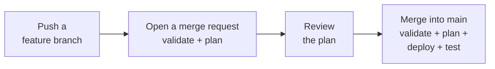
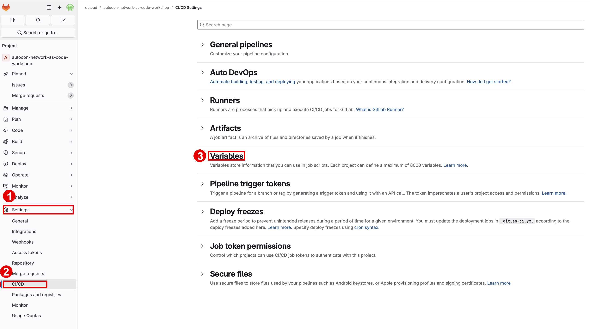
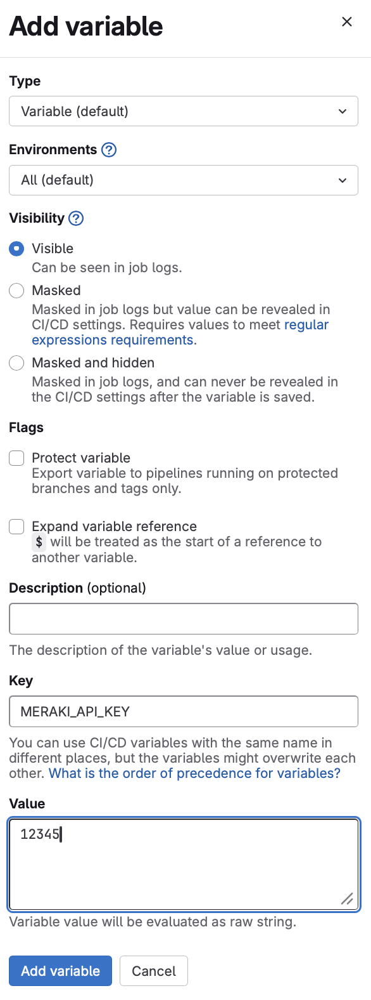

# Step 7 - Configure Meraki Networks with a CI/CD Pipeline

So far you've run the nac loop by hand, on your own machine. In
production, a **CI/CD pipeline** runs the same commands automatically for
every change. In this step you hand your network over to a GitLab pipeline,
which gives a team:

- **A single source of truth** - the Git repo, not someone's laptop,
  defines what's deployed.
- **Parallel work** - several people prepare changes on their own branches
  at the same time, and each one is reviewed before it goes live.
- **A full audit log** - every change is a commit and a merge request:
  who changed what, when, why, and who approved it.
- **The same execution environment for everyone** - every change runs
  through the same container, tool versions, and checks, no matter who
  makes it.

## CI/CD in a Nutshell

A few terms you'll meet in this step:

- **Branch** - a separate line of work in Git. `main` holds what's
  deployed; you make changes on a **feature branch** and merge them in
  when they're ready.
- **Push** - uploads your commits to the server, here your GitLab
  project.
- **Merge request (MR)** - GitLab's request to merge a feature branch into
  `main`. It's where a change is reviewed before it goes live.
- **Pipeline** - a set of **jobs** GitLab runs automatically on every push,
  defined in `.gitlab-ci.yml` at the repo root. Each job runs a few
  commands in a fresh container and can keep files it produced as
  **artifacts**.

In this lab, the flow looks like this:



The pipeline in this repo has four jobs - the same `nac` commands you ran
by hand:

| Job | Runs on | What it does |
|---|---|---|
| `validate` | every push | `nac validate` |
| `plan` | merge requests and `main` | `nac plan`, kept as an artifact for review |
| `deploy` | `main` only | `nac apply` of that plan - the only job that changes your Meraki organization |
| `test` | `main` only | `nac test` against the live Dashboard |

A merge request only *previews* a change. Nothing is deployed until you
merge it into `main`.

## Store the State in GitLab

Every pipeline job starts from a fresh copy of the repo and is thrown away
afterwards, so a local `terraform.tfstate` would be lost after each run.
The pipeline stores the state in your GitLab project instead. Add a
`terraform` block at the top of `meraki/main.tf` in VS Code:

```hcl
terraform {
  backend "http" {
    skip_cert_verification = true
  }
}

module "meraki" {
  source  = "netascode/nac-meraki/meraki"
  version = "0.13.0-beta.1"

  yaml_directories = ["data"]
}
```

`skip_cert_verification` is needed because the lab's GitLab uses a
self-signed certificate. The rest - where the state lives and how to log
in - the pipeline fills in through variables in `.gitlab-ci.yml`.

This state starts empty, which is why you ran `nac destroy` at the end of
[step 6](Meraki06_templates.md#clean-up-run-nac-destroy): the pipeline's
first run rebuilds your branch network from scratch. From here on, make
every change through the pipeline - local `nac` commands no longer have
access to the state.

## Open Your GitLab Project

Open your GitLab project in the browser:

- URL: [https://gitlab.198.18.133.103.nip.io/dcloud/autocon-network-as-code-workshop](https://gitlab.198.18.133.103.nip.io/dcloud/autocon-network-as-code-workshop)
- Username: `dcloud`
- Password: `C1sco12345`

The menu on the left is where you'll find everything in this step:

- **Settings > CI/CD** - the pipeline's variables
- **Code > Merge requests** - your merge requests
- **Build > Pipelines** - every pipeline run, its jobs, and their logs

## Add Your CI/CD Variables

The pipeline can't read your local `.env`, so it needs its own copy of
your pod-specific values. Open `.env` in VS Code to look them up:

| Variable | Value |
|---|---|
| `MERAKI_API_KEY` | your personal Meraki Dashboard API key |
| `org_name` | your workshop's Meraki organization name |
| `branch_name` | your pod's unique network name |
| `branch_mx_serial` | your pod's MX appliance serial |
| `branch_ms_serial` | your pod's MS switch serial |
| `branch_cw_serial` | your pod's CW access point serial |

Everything else the pipeline needs is already in `.gitlab-ci.yml`.

In GitLab, go to **Settings > CI/CD**, expand **Variables**, and click
**Add variable**:

<figure markdown="span">
  { width="80%" }<figcaption>**(1)**
  Settings, **(2)** CI/CD, **(3)** Variables, then **Add
  variable**.</figcaption>
</figure>

For each of the six variables:

1. Under **Visibility**, pick **Masked** for `MERAKI_API_KEY`, so it never
   shows up in job logs. Keep **Visible** for the other five.
2. Leave **Protect variable** unticked - protected variables only reach
   pipelines on `main`, so the merge request pipeline would fail.
3. Enter the name under **Key** and the value under **Value** (without
   quotes), then click **Add variable**.

<figure markdown="span">
  { width="50%" }<figcaption>The
  **Add variable** dialog. Leave the other fields as they are.</figcaption>
</figure>

## Connect Your Repo to GitLab

Your repo still points at the public starter repo you cloned in
[Environment Setup](Intro02_environment.md). In your WSL terminal, in that
repo, point it at your GitLab project instead, and do a one-time Git setup:

```sh
git remote set-url origin https://gitlab.198.18.133.103.nip.io/dcloud/autocon-network-as-code-workshop
git config --global http.sslVerify false
git config --global credential.helper 'cache --timeout=3600'
git config --global user.name "Your Name"
git config --global user.email "you@example.com"
```

- `http.sslVerify false` accepts the lab GitLab's self-signed certificate.
  Only do this on a lab machine.
- `credential.helper` remembers your GitLab login for an hour.
- Git labels every commit with a name and email - any will do.

Run all `git` commands in this step from the WSL terminal: VS Code's
built-in Git buttons use a separate Git installation without this setup.

## Push `main` First

Your GitLab project starts empty. Push `main` first, unchanged, so there is
a `main` to merge into:

```sh
git push -o ci.skip -u origin main
```

When asked, enter your GitLab login (username `dcloud`, password
`C1sco12345`). `-o ci.skip` skips the pipeline for this push - there's nothing to deploy
yet.

!!! warning "Push `main` before any other branch"
    GitLab makes the first branch pushed to an empty project its **default
    branch**, and the pipeline deploys from the default branch.

## Push Your Configuration

Create a feature branch, commit everything under `meraki/` - your updated
`main.tf` and the files you moved into `data/` in steps 2-6 - and push it:

```sh
git checkout -b cicd-demo
git add meraki/
git commit -m "Deploy the branch network through the pipeline"
git push -u origin cicd-demo
```

## Open a Merge Request

The output of `git push` ends with a link to create a merge request for
`cicd-demo` - open it in the browser. (Alternatively, go to **Code > Merge
requests** and click **New merge request**, with `cicd-demo` as source and
`main` as target.) Keep the defaults and click **Create merge request**.

The merge request starts a pipeline with `validate` and `plan`. Its status
shows on the merge request's **Overview** tab - click the pipeline to see
its jobs, and click a job to see its log.

## Review the Plan

Once `plan` is done, the **Overview** tab shows a Terraform report: how many
resources the change would add, change, and delete. For the full plan,
open the `plan` job, click **Browse** under **Job artifacts** on the right,
and open `meraki/plan.txt`.

Because the pipeline's state starts empty, this first plan rebuilds your
whole branch network: only additions, nothing to change or delete.

## Merge and Deploy

On the merge request's **Overview** tab, click **Merge**. This starts a new
pipeline on `main` - find it under **Build > Pipelines**. This time all four
jobs run: `deploy` applies the plan to your Meraki organization, and `test`
checks the result. The `deploy` job log ends with:

```text
Apply complete! Resources: 69 added, 0 changed, 0 destroyed.
```

The pipeline's **Tests** tab lists the test results. Your branch network is
back in the [Meraki Dashboard](https://dashboard.meraki.com), now managed
by the pipeline.

## Make a Change

Every change now takes the same route. Start a new branch from the latest
`main`:

```sh
git checkout main
git pull
git checkout -b cicd-change
```

Change the `notes` of your network in `meraki/data/3_networks.nac.yaml`,
then commit and push:

```sh
git add meraki/data/3_networks.nac.yaml
git commit -m "Update the network notes"
git push -u origin cicd-change
```

Open a merge request again. This time the Terraform report shows a single
change. Merge it, and check the `deploy` job log for
`Apply complete! Resources: 0 added, 1 changed, 0 destroyed.` - then find
the new notes in the Dashboard.

## If a Job Fails

Open the failed job and read its log - the error is the same you'd have
seen running the command locally.

- `validate` or `plan` failed: nothing was deployed. Fix the YAML on your
  branch, commit, and push again - the merge request picks up the new
  pipeline.
- `deploy` failed: whatever was applied before the error stays applied.
  Start a new pipeline on `main` under **Build > Pipelines > New
  pipeline** - retrying only the `deploy` job would apply the old plan. If
  it failed right after claiming a device with a `404`, a new pipeline is
  usually enough.

---

**← Previous:** [Templates](Meraki06_templates.md) · **Next:** [Part 2 - IOS-XE: SSH to devices](IOSXE01_ssh.md)
